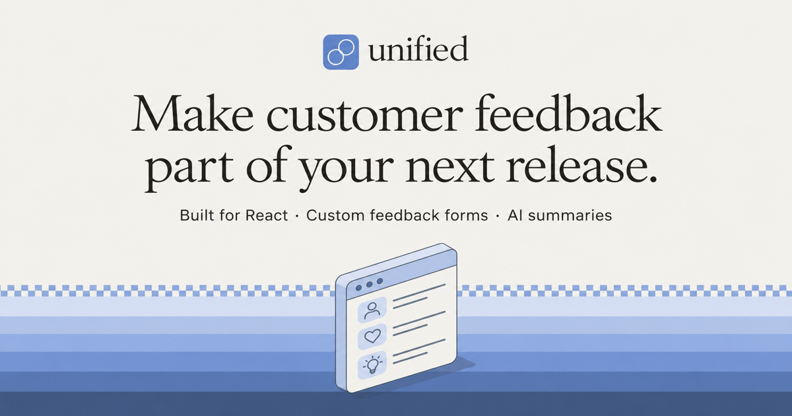
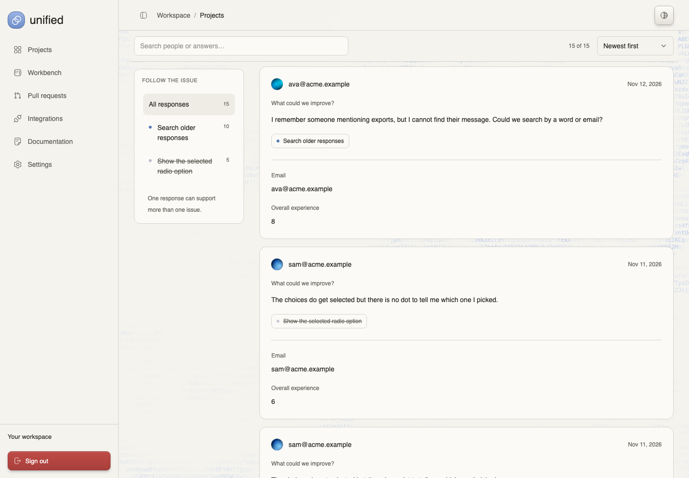
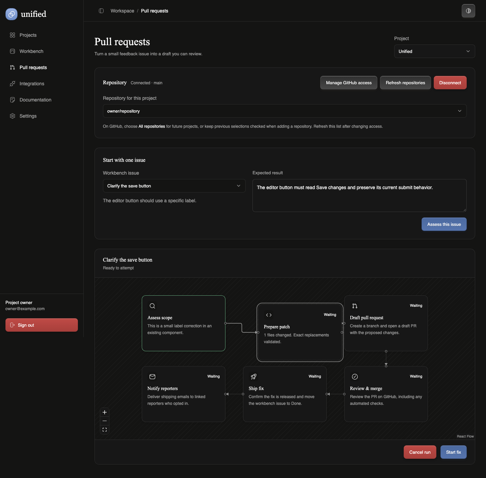

# unified



a feedback widget for your React app, and somewhere to actually do something with the responses.

collecting feedback is the easy bit. then you have a pile of answers, a few people asking for the same thing, and no connection between what they said and what you shipped. unified puts the form, responses, issues and draft PRs in one place - with Slack and email digests so you don't have to keep checking the dashboard.

[try it](https://unified-chi.vercel.app) · [docs](https://unified-chi.vercel.app/docs) · [npm](https://www.npmjs.com/package/unified-sdk) · [llms.txt](https://unified-chi.vercel.app/llms.txt)

## what it does

start with a project. add your questions by hand, or describe the form with text or voice. pick the colors, theme and launcher, then drop the widget into your app.

responses land in the dashboard. AI summaries pull out recurring requests, and the workbench keeps issues linked to the feedback behind them. you can move those through to done, or connect a GitHub repo and attempt a small fix as a draft PR.

you still review the code and merge it yourself. after releasing, mark it shipped and unified can email the reporters who asked to hear back. merging a PR alone doesn't send those emails.

if you already have a form, keep it. there's a server-side submission API too.

## a look inside

these are screenshots of the app with sample data. responses on one side of the process, a draft fix on the other.

<details open>
<summary>responses and linked issues</summary>



</details>

<details>
<summary>from an issue to a draft PR</summary>



</details>

## add the widget

create a project in the [workspace](https://unified-chi.vercel.app/dashboard), then grab its project ID from Preview. run this from your Vite or Next.js app:

```sh
npx unified-sdk@2.3.0 init --project YOUR_PROJECT_ID --api-url https://YOUR_BACKEND_HOST
```

that's the automatic setup. it checks your app entry, installs the SDK, adds the stylesheet and mounts the widget. add `--dry-run` if you want to see what it'll change first.

you need Node.js 20.19+ for the CLI and React 18 or 19 in your app. for Next.js, setup creates a client component and leaves your layout as a server component.

or do it manually:

```sh
npm install unified-sdk
```

```jsx
import { UnifiedFeedback } from "unified-sdk";
import "unified-sdk/dist/unified-sdk.css";

export default function App() {
  return (
    <UnifiedFeedback
      projectId="YOUR_PROJECT_ID"
      apiUrl="https://YOUR_BACKEND_HOST"
      theme="auto"
    />
  );
}
```

import the stylesheet once. if you're adding it manually in Next.js, the widget belongs in a client component.

## make it yours

most of the appearance lives in the project settings. use props when you want to override it for a particular app:

| prop | what it takes | default |
| --- | --- | --- |
| `projectId` | your public project ID | required |
| `apiUrl` | your backend origin | `http://localhost:8000` |
| `theme` | `auto`, `project`, `light`, `dark` | `auto` |
| `triggerStyle` | `pill`, `rounded`, `icon`, `text`, `tab` | project setting |
| `position` | `bottom-left`, `bottom-right` | project setting |

`auto` follows the host app and system theme. `project` uses the mode you saved in the dashboard. the widget uses Shadow DOM to keep its styles contained.

one thing that's easy to miss: dragging the launcher onto its delete target hides it across refreshes. that's saved per API origin and project. clear site storage to bring it back (which also clears other saved preferences for that site).

and set `apiUrl` before deploying. the localhost default is only useful on your machine.

## your own form

you don't need the widget if you've already built a form. create matching questions in unified, open Preview → Custom form, then generate a submission key and copy the question IDs.

send this from your server:

```js
const response = await fetch(
  `${process.env.UNIFIED_API_URL}/api/submissions/${process.env.UNIFIED_PROJECT_ID}`,
  {
    method: "POST",
    headers: {
      "Content-Type": "application/json",
      Authorization: `Bearer ${process.env.UNIFIED_SUBMISSION_KEY}`,
    },
    body: JSON.stringify({
      formAnswers: { QUESTION_ID: "your answer" },
    }),
  },
);

if (!response.ok) throw new Error("could not send feedback");
```

answers use question IDs, not the labels you gave them. text, email, choices and dates are strings, sliders are numbers. dates use `YYYY-MM-DD`. include every required answer.

the project ID can live in your frontend. the submission key stays on your server, and only lets you submit responses. replacing or revoking it disables the old key. there's more on validation and response codes in the [docs](https://unified-chi.vercel.app/docs).

## the PR bit

honestly, this part has a fairly narrow scope. it attempts focused React UI and documentation fixes, with at most 3 existing files edited and 120 changed lines. no new dependencies, file creation, test edits, backend changes, auth, payments or infrastructure work.

assessment reads the repo at a fixed commit. the worker prepares a patch, checks its boundaries, and opens a draft PR. GitHub runs whatever CI the repo already has. a model saying the patch looks fine isn't a passing test, and a repo without CI still needs manual verification.

review it before merging. the full setup, limits and recovery behavior are in [the workflow notes](docs/pull-request-workflow.md).

## run it locally

there are 3 npm packages here, plus shared form code:

```text
frontend/       dashboard, public site and docs - React 19, Vite, Tailwind
backend/        API, MongoDB models and workers - Express 5
unified-sdk/    widget, types, styles and the setup CLI
shared/         fields, themes, fonts, controls and launcher settings
docs/           workflow notes and README screenshots
```

use Node.js 20.19+ and a MongoDB replica set. Atlas works, a standalone MongoDB instance won't cover the transactions used for deletion and workflow locks.

```sh
git clone https://github.com/romeirofernandes/unified.git
cd unified
npm run install:all
cp backend/.env.example backend/.env
```

add these to `backend/.env`, then fill in whichever integrations you need from the example:

```dotenv
PORT=8000
MONGO_URI=mongodb://localhost:27017/unified?replicaSet=rs0
FIREBASE_PROJECT_ID=your-project-id
FIREBASE_API_KEY=your-firebase-web-api-key
FRONTEND_URL=http://localhost:5173
```

create `frontend/.env` with your Firebase web app config:

```dotenv
VITE_BACKEND_URL=http://localhost:8000
VITE_FIREBASE_API_KEY=your-firebase-web-api-key
VITE_FIREBASE_AUTH_DOMAIN=your-project.firebaseapp.com
VITE_FIREBASE_PROJECT_ID=your-project-id
VITE_FIREBASE_STORAGE_BUCKET=your-storage-bucket
VITE_FIREBASE_MESSAGING_SENDER_ID=your-sender-id
VITE_FIREBASE_APP_ID=your-app-id
VITE_FIREBASE_MEASUREMENT_ID=your-measurement-id
```

enable Firebase authentication and configure the allowed domains for your app. keep the Groq keys and integration secrets in the backend. anything prefixed `VITE_` ends up in the browser.

then, in separate terminals:

```sh
npm run dev:backend
npm run dev:frontend
```

API on 8000, frontend on 5173. set `GROQ_API_KEYS` for summaries and other AI features. Slack, email, GitHub and payments need their own credentials, so getting every feature running does take a bit of setup. [integration notes here](backend/INTEGRATIONS.md).

## checks

```sh
npm test
npm run lint
npm run build
npm run test:consumer
```

`build` builds the frontend and SDK. it also generates `/docs.md`, `/llms.txt`, page metadata, robots.txt and the sitemap. edit the source docs or build script if you're changing those, the generated files get replaced on the next build.

## more details

- [SDK README](unified-sdk/README.md) for CLI flags and widget behavior
- [prop types](unified-sdk/types/index.d.ts) for the component's supported props
- [feedback workflow](docs/feedback-workflow-checkpoints.md) for summaries, issues and shipping updates
- [draft PR workflow](docs/pull-request-workflow.md) for GitHub setup and the boring recovery cases
- [machine-readable guide](https://unified-chi.vercel.app/llms.txt) if you're handing setup to an agent

if you try it and something breaks, [open an issue](https://github.com/romeirofernandes/unified/issues). include your SDK version and what you expected to happen - makes it a lot easier to figure out :)
